# 妖怪だより

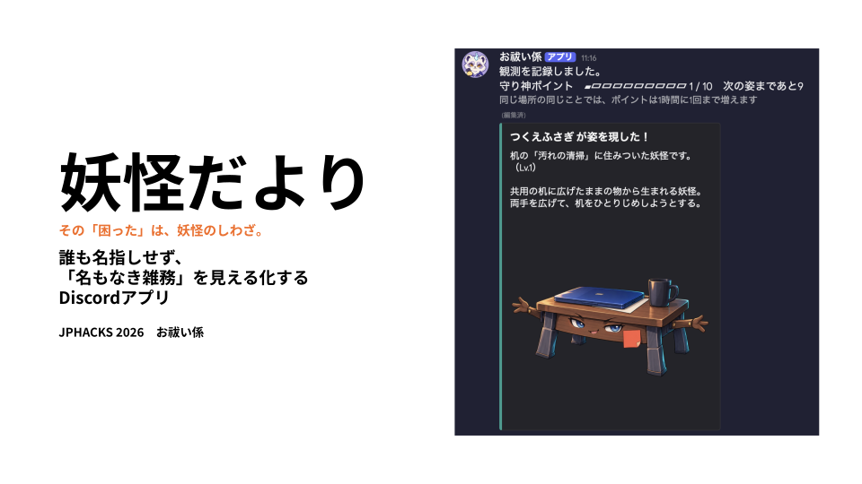


<p align="center"><strong>その「困った」は、妖怪のしわざ。</strong></p>

研究室の「名もなき雑務」を、誰かの失敗ではなく **妖怪という共通の問題** に変える Discord Bot です。気づいた人が選択式で記録し、同じ問題が繰り返されると妖怪が出現・成長します。問題が起きなくなると妖怪は成仏します。

## デモ動画

[▶️ 紹介動画を見る（YouTube・約3分）](https://youtu.be/7XldvmdmH-A)

発表（90秒）では入りきらなかった、管理者の画面や守り神の進化まで、実際の Discord の画面で紹介しています。動画を見なくても分かるように、同じ流れを下の「画面で見る使い方」に写真と文章でまとめました。

## 画面で見る使い方

以下はすべて、実際に動かしたときの Discord の画面です。

### 1. 導入：コマンド1つで準備が終わる（`/youkai-junbi`）

管理者が `/youkai-junbi` を打つと、3つのチャンネルと、場所・雑務の初期一覧ができあがります。

| チャンネル | 見られる人 | 役割 |
| --- | --- | --- |
| `#お祓い係の控え室` | 全員 | `/youkai` で観測し、`/mamorigami` で自分の守り神を見る場所。返事はすべて本人にだけ見える |
| `#毎日報告` | 全員 | 1日1回の「妖怪だより」が届く場所 |
| `#管理者` | 管理者と Bot だけ | 匿名の「ひとこと」と、「一覧にない」報告が届く場所 |

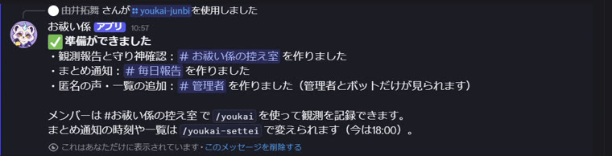

控え室には、使い方の案内を Bot が1回だけ投稿します。

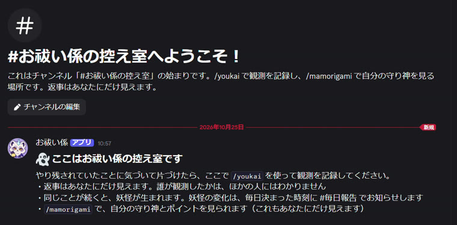

### 2. 管理者の設定：選ぶだけ（`/youkai-settei`）

妖怪だよりを届けるチャンネルと時刻、場所の一覧、何回目で妖怪が生まれるか、雑務の一覧を、フォームで選んで保存します。ここでは新しい雑務「プリンターのトナー切れ」を追加しました。

雑務の一覧には、**普段あってはいけない状態だけ** を入れます（ゴミの回収のような周期的な仕事は入れません）。また、一覧に `器具の洗浄=1` のように書くと、その雑務だけ1度目で妖怪が出ます。書かなかった雑務は、研究室全体の値（例：3度目）を使います。

```text
洗い物が残っていた
器具の洗浄=1
プリンターのトナー切れ=1
出しっぱなし
```

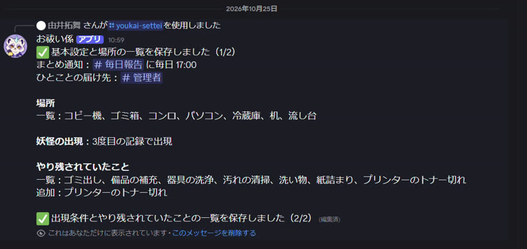

### 3. 観測：選ぶだけで記録できる（`/youkai`）

片づけた人は `/youkai` で「場所」と「やり残されていたこと」を選んで送るだけです。返事は本人にしか見えず、誰が観測したかは記録に残りません。

初めて観測した人には、自分だけの守り神を選ぶ画面が出ます。

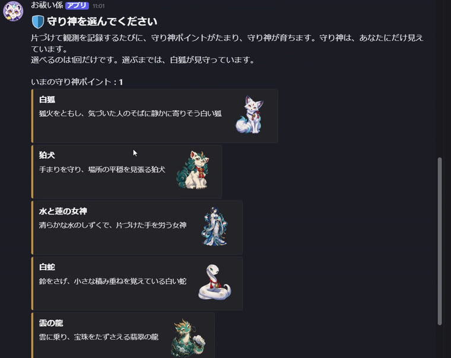

同じ場所で同じことが続くと、返事のカードが「気配」（灰色）→「影」（紫）と変わっていきます。カードには、守り神ポイントと次の姿までのバーも出ます。

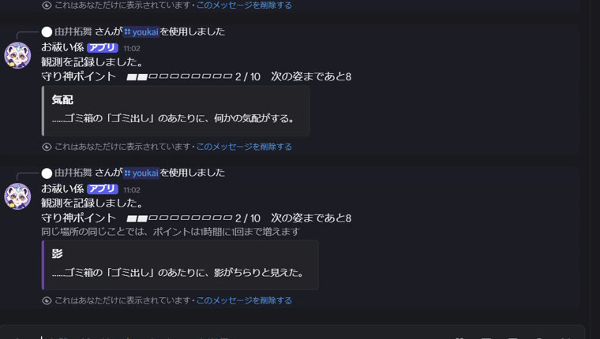

3回目（回数は管理者が設定）で、妖怪が姿を現します。名前・紹介文・画像つきのカードです。

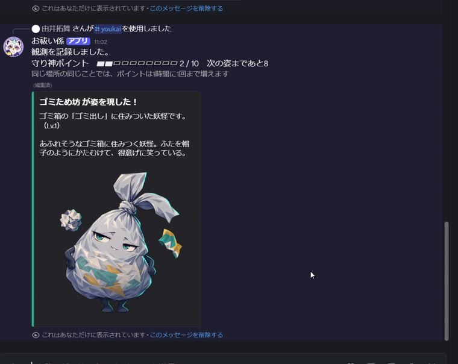

### 4. 一覧にない困りごと：匿名で管理者に届く

一覧にないことに気づいたら、「一覧にない」を選び、「ひとこと」に書いて送ります。

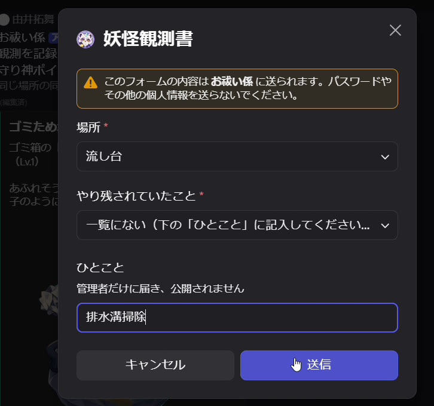

ひとことは、**誰が書いたかを付けずに** `#管理者` にだけ届きます。管理者はボタン1つで選択肢に追加でき、そのときこの観測も1回目として数えられます。

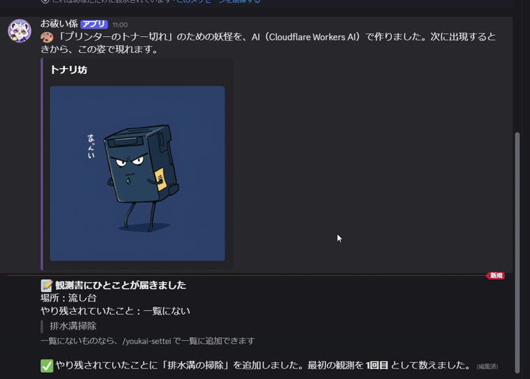

### 5. その研究室だけの妖怪：AIがその場で作る

管理者が新しく追加した雑務には、生成AI（Cloudflare Workers AI）が名前と姿を考えて、その研究室だけの妖怪を作ります。上の画像の「トナリ坊」（プリンターのトナー切れ）と、下の「スッキリ坊」（排水溝の掃除）は、どちらもこの撮影中に AI が作ったものです。AIに渡すのは雑務の名前だけで、ひとことの文章は渡しません。

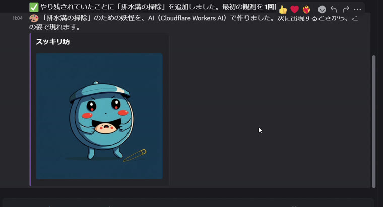

### 6. 妖怪だより：1日1回、まとめて届く（`/summary`、`/now`）

妖怪の変化は、すぐには公開しません。管理者が決めた時刻に、`#毎日報告` へまとめて届きます（`/summary` で今すぐ送ることもできます）。**誰が、いつ観測したかは、どこにも書かれません。**

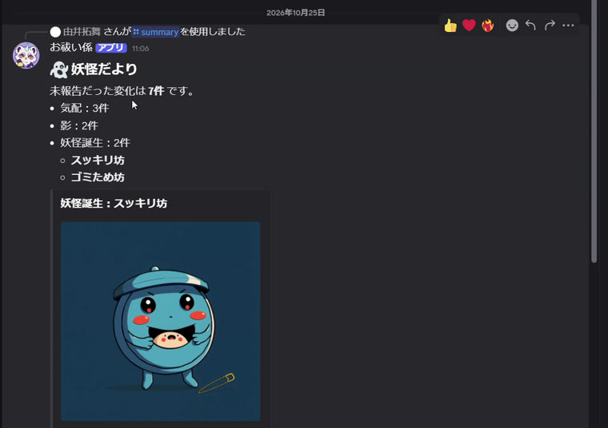

`/now` で、いま活動中の妖怪を場所ごとに見られます。生まれたばかりの妖怪は、妖怪だよりで知らされるまで `/now` にも出ません。

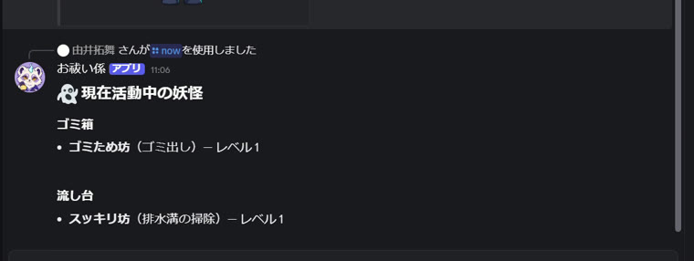

### 7. 守り神：自分にだけ見える成長（`/mamorigami`）

片づけを記録するたびに守り神ポイントがたまり、10・30・60・100 ポイントで守り神が進化します。他の人とは比べず、本人にだけ見えます。

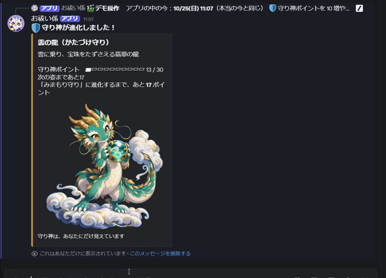

### 8. 成仏：問題が起きなくなった証

最後の観測から一定の日数、誰も観測しなかった妖怪は成仏し、お札のついた姿で妖怪だよりに載ります（撮影では `/demo` でアプリの中の時間を進めています）。

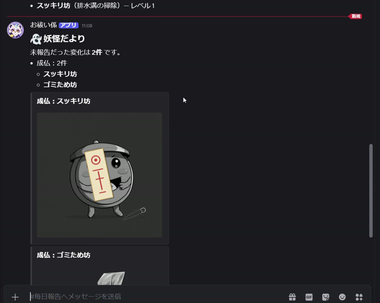

## 解決したいこと

研究室には、流しに残った洗い物、あふれたゴミ箱、つけっぱなしの電気、切れたままの消耗品など、誰の担当でもない「名もなき雑務」があります。気づいた人が黙って片づけていますが、片づけるのはいつも同じ人に偏りがちです。

この偏りを口にするのは簡単ではありません。「また洗い物が残っていた」と言えば、「誰が残したのか」という責任追及になり、言った人も言われた人も気まずくなります。そのため、片づける人は不満をため、残す人は問題に気づかない状態が続きます。

一般的なタスク管理ツールは、担当者と期限を決めることを前提にしています。しかし、名もなき雑務に担当者を置くと、「やらなかった人」を特定する仕組みになり、今回避けたい対人摩擦を強めます。

そこで私たちは、**誰も名指しせず、問題が繰り返し起きていることだけを伝える** 方法を考えました。妖怪だよりは、個人ではなく問題そのものを「妖怪」として可視化し、研究室全体が置き場所や運用の改善を話し合える状態をつくります。

私たちが注目したのは、汚れそのものではありません。**「誰が残したの？」と言えない気まずさ**が、問題を続けさせていることです。

## なぜ「妖怪」なのか

<p align="center"><strong>犯人探しを、妖怪探しに。</strong></p>

昔の人は、誰のせいとも言えない困りごとを「妖怪のしわざ」と呼んできました。誰かを責めずに、起きていることに名前をつけて向き合うための知恵です。私たちは、この知恵を研究室に持ちこみました。

- **人ではなく、問題に名前がつく**：「あらいわすれ坊がまた出た」と言えば、誰も責めずに洗い物の話ができます。
- **「報告」ではなく「観測」**：誰かを訴えるのではなく、起きていることをただ記録するので、観測書と呼んでいます。
- **問題が消えれば、妖怪も消える**：置き場所や当番を話し合い、同じことが起きなくなると、妖怪は成仏します。
- **頑張りは、本人にだけ見える**：片づけた人には守り神が育ちます。人と比べるランキングにはしません。

## 特長

### 1. 誰も名指ししない仕組み

観測記録には報告者を残さず、記録直後の全体通知もしません。公開する場所と雑務は管理者が登録した選択肢に限定し、自由記述は管理者だけに匿名で届けます。「名前を出さないように気をつける」のではなく、**個人を名指しする情報が全体へ出にくい仕組み**にしています。

### 2. 繰り返す問題だけを妖怪にする

1回の出来事をすぐ問題として公開せず、同じ場所で同じ雑務が繰り返されたときにだけ妖怪が出現します。記録が続けば成長し、誰も片づけなくてよい状態が続けば成仏します。個人の失敗ではなく、**繰り返し起きている環境や運用の問題**を共有します。

**「健全な状態」は雑務ごとに違う**ので、何回目で妖怪が出るかを雑務ごとに決められます。器具の洗い忘れやトナー切れのように **1回でも困ること** は1回目で、出しっぱなしのように **ときどきなら困らないこと** は数回目で妖怪になります。健全な研究室には、妖怪は出ません。

### 3. Discordの中で、選ぶだけで観測できる

新しいアプリへの登録は不要です。普段使っているDiscordで場所と雑務を選ぶだけで観測でき、現在の妖怪、定時の妖怪だより、守り神、管理者設定まで完結します。一覧にない雑務も管理者が追加でき、その研究室だけの妖怪を生成AIが作ります。

## 既存手段との違い

**当番表は「誰が」やるかを決めます。妖怪だよりは「何が」繰り返されているかだけを見せます。**

妖怪だよりの独自性は、匿名化、反復問題の状態管理、ゲーミフィケーションを、**誰も責めずに共同空間を改善する一つの体験**として組み合わせた点にあります。

| 既存の手段 | 主な目的 | 妖怪だよりとの違い |
| --- | --- | --- |
| タスク管理 | 担当者と期限を決めて仕事を進める | 担当者を置かず、場所 × 雑務の反復を問題として扱う |
| 匿名投稿・相談 | 名前を出さずに意見や出来事を伝える | 公開内容を選択式に限定し、単発の投稿ではなく反復回数と状態を管理する |
| タスクのゲーミフィケーション | 個人の達成や継続を楽しくする | 個人の成績ではなく、共同空間の問題を妖怪の出現・成長・成仏で表す |
| 問題を比喩で捉えるワークショップ | 対話の中で問題を捉え直す | Discord上で継続的に観測し、決まった時刻に変化を共有する |

## 体験の流れ

1. やり残されたことを片づけた人が `/youkai` を実行し、「場所」と「やり残されていたこと」を選びます。
2. 同じ場所 × 雑務の記録が増えると、「気配」→「影」→「出現」と変化します。出現後は記録数に応じてレベルと姿が変わります。
3. 全体チャンネルには、指定時刻に未通知の変化をまとめた「妖怪だより」が届きます。生まれた妖怪には「**お祓いの作法**」（例：ゴミ → 8割たまったら気づいた人がまとめて出す。ゴミの日を貼り出しておくと効く）を添え、今まで片づけていなかった人にも、どうすれば残らなくなるかを名前を出さずに伝えます。
4. 最後の記録から一定日数が経過すると、妖怪は成仏します。
5. 片づけを記録した本人には守り神ポイントがたまり、守り神が成長します。
6. 一覧にない困りごとは「ひとこと」で管理者に届きます。管理者がボタン1つで選択肢に追加すると、その観測も1回目として数えられ、**その研究室だけの新しい妖怪を生成AIが作ります**。

## 主な機能

| コマンド | 公開範囲 | 内容 |
| --- | --- | --- |
| `/youkai` | 操作結果は本人のみ | 場所と雑務を選び、妖怪を観測する。任意のひとことは管理者だけに届く |
| `/now` | チャンネル全体 | 場所ごとに、妖怪だよりで誕生を通知済みの妖怪・雑務・レベルと、お祓いの作法を表示する |
| `/summary` | チャンネル全体 | 成仏判定後、未送信の妖怪の変化をその場でまとめて通知する |
| `/mamorigami` | 本人のみ | 自分の守り神、ポイント、レベルを確認する |
| `/youkai-junbi` | 管理者のみ | 3つのチャンネル（`#お祓い係の控え室`：観測し、自分の守り神を見る場所、`#毎日報告`：妖怪だよりが届く場所、`#管理者`：ひとことが届く場所）と、場所・雑務の初期一覧を自動作成する |
| `/youkai-settei` | 管理者のみ | 通知先、通知時刻、出現回数、場所・雑務の一覧を設定する。雑務ごとの出現回数は、一覧に「器具の洗浄=1」のように書く |
| `/demo` | 管理者のみ | 発表・撮影用。アプリの中の時間を進める、妖怪だよりを今すぐ送る、守り神ポイントを増やす、リセットする |

### 妖怪のライフサイクル

```text
presence（気配） → shadow（影） → active（出現・成長） → ascended（成仏）
```

- 出現回数はサーバーごとに設定できます。さらに雑務ごとに変えられます（`/youkai-settei` の一覧に「器具の洗浄=1」と書くと、その雑務だけ1度目で出現）。器具の洗い忘れのように1回でも困るものはすぐに、出しっぱなしのように続くと困るものは数回目で妖怪になるので、「健全な状態」を雑務ごとに決められます。
- 出現後のレベルは `報告数 - 出現に必要な報告数 + 1` で計算します。
- Lv.1 / 5 / 10 / 25 で表示画像が変わります。
- 成仏判定は、定時通知または `/summary` の直前に行います。

## プライバシー設計

「名前を出さないように気をつける」のではなく、名前が公開されにくいデータ構造と通知方式にしています。

| 守ること | 実装 |
| --- | --- |
| 誰が記録したかを残さない | `reports` に報告者の列を持たせない |
| 守り神の集計と匿名性を両立する | Discord ID は保存せず、秘密値を鍵に HMAC-SHA256 で生成した仮名識別子 `member_key` だけを使用する |
| 通知時刻から報告者を推測させない | 記録直後に全体通知せず、指定時刻のダイジェストにまとめる |
| 自由記述から個人を特定させない | ひとことは管理者チャンネルだけに匿名で送り、DBには保存しない |
| 公開メッセージを制御する | 場所・雑務は管理者が登録した選択肢を使い、メンションを無効化する |
| 初期段階の問題を晒さない | `presence` と `shadow` は本人への応答だけで扱う |

## 守り神

片づけの記録を続ける動機を、他人との競争ではなく「自分だけに見える成長」に変える仕組みです。

- 1回の有効な記録につき1ポイント
- 同じ人 × 場所 × 雑務では1時間に1回まで加算
- 初回に守り神を選択し、Lv.1 / 10 / 30 / 60 / 100 で姿が変化
- ポイントや守り神は `/mamorigami` を実行した本人だけに表示
- 次の姿までの進み具合を、`▰▰▰▰▱▱▱▱▱▱ 18 / 30　次の姿まであと12` のようなバーで表示
- `/mamorigami` では、「この研究室の片づけのうち、あなたが担ったのは約30%です」のように、自分が担った割合も本人にだけ表示（10%きざみ）

## かたより坊：片づけの偏りも、妖怪にする

「片づけるのは、いつも同じ人」という偏りそのものを、人ではなく妖怪として研究室に見せます。

> 守り神は、あなたの頑張りを、あなたにだけ見せる。かたより坊は、頑張りの偏りを、名前なしで研究室に見せる。

偏り度 ＝ いちばん多く片づけた1人の割合 ÷（1 ÷ 研究室の人数）。つまり「みんなで同じだけ片づけたときの何倍を、1人が担っているか」です。

| 段階 | 偏り度 | 9人の研究室だと | 妖怪だよりに出ること |
| --- | --- | --- | --- |
| 健全 | 2倍未満 | 1人が約22%未満 | 何も出ない |
| 気配 | 2倍以上 | 1人が約22%以上 | 「片づけの分担：少し偏ってきたようです」 |
| 出現 | 3倍以上 | 1人が1/3以上 | **かたより坊が出現**。お祓いの作法「当番や置き場所を、研究室で話し合ってみよう」 |

- 比べる相手は「片づけた人」ではなく「研究室の人数」です。2人だけが半分ずつ片づけていても、10人の研究室なら、残りの8人が何もしていない大きな偏りとして判定します。
- **名前が分からないように**：片づけた人が3人未満のときや、片づけの合計が10回未満のときは出しません。妖怪だよりには段階だけを出し、人数や割合は出しません。
- 守り神ポイント（片づけの回数）から計算するので、データベースの形は変えていません。

## 新しい雑務には、その研究室だけの妖怪を

研究室ごとに、困りごとは違います。そこで画像の役割を2つに分けました。

| 場面 | 画像の作り方 | 理由 |
| --- | --- | --- |
| よくある雑務（洗い物・ゴミ・消し忘れなど10種類） | 事前に生成AIで作り込んだイラスト（妖怪40枚・守り神25枚）。成仏の姿は、それを画像処理で白黒にしてお札を重ねたもの | 一番目にふれる場面なので、画風をそろえて作り込む |
| 管理者が新しく追加した雑務（例：紙詰まり） | **その場で生成AI（Cloudflare Workers AI）が作る**。文章のAIが名前と見た目を考え、画像のAIが姿を描き、成仏の姿は画像処理で作る | どの研究室にどんな雑務があるかは、前もって全部はわからない |

- **AIに渡すのは、管理者が登録した項目の名前（「紙詰まり」など）だけ** です。報告者の自由記述は渡しません。
- 一覧にない困りごとを「ひとこと」で報告した人の観測は、管理者が管理者チャンネルのボタンから選択肢に追加した時点で、1回目として数えます。二度押しても1回だけです。ひとことの文章そのものは保存しません。
- AIが使えないとき（無料の範囲を超えた、通信の問題など）も、Botは止まらず、決まった妖怪のまま動き続けます（[tests/custom-yokai.test.mjs](tests/custom-yokai.test.mjs)）。
- 実際の生成例：「紙詰まり」→「かみため坊」（[src/assets/birth/](src/assets/birth/) の `custom_*.png`）

## 要件定義

「誰も責めずに、名もなき雑務を減らす」を具体的な要件に落とし、それぞれを実装とテストで確かめました（4は、Hack Day 中に審査員から受けた指摘をもとに加えた要件です）。

| # | 要件 | なぜ必要か | どう満たしたか | 確かめ方 |
| --- | --- | --- | --- | --- |
| 1 | 観測の記録に、誰が観測したかを残さない | 観測した人が「告げ口した人」にならないため | `reports` に報告者の列を持たせない。守り神の集計は、Discord ID を HMAC-SHA256 で変換した仮の値だけで行い、Discord ID そのものは保存しない | [report-session.ts](src/database/report-session.ts)、[tests/demo-guardian.test.mjs](tests/demo-guardian.test.mjs)（Discord ID そのものを保存しないこと） |
| 2 | 観測した時刻から、人を推測させない | 記録の直後に全体へ出ると「今の人だ」と分かるため | 全体への知らせは1日1回の妖怪だよりにまとめる。生まれたばかりの妖怪は、妖怪だよりで知らせるまで `/now` にも出さない | [tests/now.test.mjs](tests/now.test.mjs) |
| 3 | 自由に書いた文章を、全体に出さない | 文章の書き方や内容から、人が分かるため | 「ひとこと」は管理者チャンネルにだけ名前なしで送り、データベースにも保存しない。AI にも渡さない | [admin-note.ts](src/notifications/admin-note.ts)、[tests/custom-yokai.test.mjs](tests/custom-yokai.test.mjs)（AI に渡すのは雑務の名前だけ） |
| 4 | 健全な研究室には、妖怪を出さない | 片づける人が増えるほど妖怪が出るのでは、続ける意味がなくなるため | 一覧には「普段あってはいけない状態」だけを入れる。何回目で妖怪が出るかを、雑務ごとに決められる | [tests/task-threshold.test.mjs](tests/task-threshold.test.mjs) |
| 5 | 同じ観測を、二重に数えない | 通信のやり直しや連打で、妖怪やポイントが増えないため | 観測ごとの ID で、同じ観測は一度しか保存しない。守り神ポイントは、同じ人 × 場所 × 雑務で1時間に1回まで | [submit_report.sql](sql/functions/submit_report.sql) |
| 6 | 知らせを取りこぼさない | Discord への送信に失敗しても、次に送り直せるようにするため | 送信に成功してから「送信済み」にする | [tests/demo.test.mjs](tests/demo.test.mjs)（送信の途中で失敗したら送信済みにしない） |
| 7 | AI が使えなくても、止まらない | 無料の範囲を超えたり、通信が切れたりしても使い続けられるようにするため | AI の失敗は、決まった名前と妖怪に置きかえて続ける | [tests/custom-yokai.test.mjs](tests/custom-yokai.test.mjs) |
| 8 | 一般のメンバーに、管理の機能を見せない | 設定やデモ用の操作を、誰でも触れると困るため | 管理用のコマンドは、サーバー管理の権限がある人にだけ表示し、コマンドの中でも確かめる | [tests/demo-guardian.test.mjs](tests/demo-guardian.test.mjs)（管理者でなければ増やさない） |
| 9 | 新しいアプリを入れずに使える | 使い始めるまでの手間を、なくすため | すべて Discord の中で完結。管理者がコマンドを1つ打つだけで、チャンネルと初期の一覧がそろう | [youkai-junbi.ts](src/commands/youkai-junbi.ts) |

## データの流れ：名前が残らない仕組み

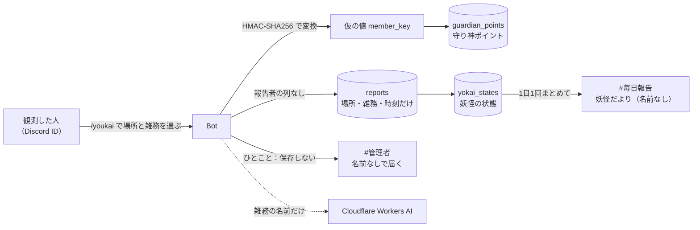

Discord ID は、Bot の中で仮の値（member_key）に変えたらすぐ捨て、データベースには保存しません。観測の記録（`reports`）には、仮の値も含めて、誰が観測したかを残しません。

ただし、守り神ポイントを「同じ人 × 場所 × 雑務で1時間に1回まで」にするために、`guardian_cooldowns` には仮の値・場所・雑務・最後にポイントを付けた時刻だけを残しています。仮の値は、Bot だけが持つ秘密の鍵がなければ元の人に戻せません。また、このテーブルは Row Level Security で Bot 以外から読めないようにしています。

## 技術構成

```text
Discord
  └─ Slash Commands / Modal / Select Menu
          │
          ▼
Node.js + TypeScript + discord.js
          │
          ▼
Supabase（PostgreSQL / RPC）
  ├─ reports            匿名の観測記録
  ├─ yokai_states       妖怪の現在状態
  ├─ notification_jobs  未送信の通知イベント
  ├─ guardian_points    守り神ポイント
  ├─ guardian_cooldowns 重複加算の抑制
  └─ pending_observations 一覧にない観測（管理者が追加するまで）

Cloudflare Workers AI（任意）
  └─ 新しく追加した雑務の妖怪の名前（Llama 3.1）と姿（FLUX.1 schnell）
```

記録、妖怪状態の更新、通知ジョブの作成、守り神ポイントの加算は、`submit_report` RPC の1トランザクションで処理します。通知はDiscordへの送信が成功した後にだけ `sent_at` を更新するため、失敗した通知を再試行できます。

## セットアップ

### 必要なもの

- Node.js
- Discord Bot（トークン、Application ID、テスト用Guild ID）
- Supabaseプロジェクト（URL、Secret key）

### 1. インストール

```bash
git clone git@github-other:jphacks/tkb_2602.git
cd tkb_2602
npm install
cp .env.example .env.local
```

`.env.local` に次を設定します。

```dotenv
DISCORD_TOKEN=
DISCORD_CLIENT_ID=
DISCORD_GUILD_ID=
SUPABASE_URL=
SUPABASE_SECRET_KEY=
MEMBER_KEY_SECRET=
# 任意：新しく追加した雑務の妖怪を生成AIで作る（なければ作らない）
CLOUDFLARE_ACCOUNT_ID=
CLOUDFLARE_API_TOKEN=
```

`MEMBER_KEY_SECRET` は同じ値を使い続けてください。変更すると、同じ利用者でも守り神ポイント上は別人として扱われます。

### 2. SupabaseへSQLを適用

Supabaseの SQL Editor で、対象環境の既存スキーマに対して次の順に実行します。

1. `sql/functions/save_guild_settings.sql`
2. `sql/migrations/20261024_notification_delivery.sql`
3. `sql/migrations/20261024_notification_jobs_presence_shadow.sql`
4. `sql/migrations/20261024_yokai_identity.sql`
5. `sql/migrations/20261024_guardians.sql`
6. `sql/migrations/20261024_demo_time_offset.sql`
7. `sql/migrations/20261024_pending_observations.sql`
8. `sql/migrations/20261024_custom_yokai.sql`
9. `sql/migrations/20261024_custom_yokai_image_key.sql`
10. `sql/functions/process_yokai_ascensions.sql`
11. `sql/functions/reset_demo_data.sql`
12. `sql/functions/submit_report.sql`

詳細とDB単体テストは [src/database/README.md](src/database/README.md) を参照してください。

### 3. Discordコマンドを登録して起動

```bash
npm run deploy
npm start
```

Botがオンラインになったら、管理権限を持つユーザーが `/youkai-junbi` を実行します。通知時刻は30分単位で設定できます。

## 開発

```bash
npm run typecheck
npm test
```

自動テストは 87 件あり、Discord や Supabase、Cloudflare には実際につながずに、通信の部分を差しかえて確かめています。

主な実装箇所：

- [src/commands/](src/commands/) — Discordコマンド
- [src/notifications/digest.ts](src/notifications/digest.ts) — 定時・手動の妖怪だより
- [src/database/](src/database/) — Supabaseとの読み書き
- [sql/functions/](sql/functions/) — トランザクション処理
- [sql/migrations/](sql/migrations/) — DB差分
- [src/assets/](src/assets/) — 妖怪・守り神の画像

## 注力したこと（設計思想と判断過程）

### 1. 「誰も名指ししない」を、機能の採否基準にした

匿名性を後から追加するのではなく、企画の初期から「この機能は、誰かを名指しする道を作らないか」を判断軸にしました。その結果、便利そうでも目的と衝突する機能は採用していません。

| 検討した案 | 採用判断 | 理由と現在の設計 |
| --- | --- | --- |
| 雑務に担当者と期限を設定する | 不採用 | 「やらなかった人」を生み、責任追及につながるため。人ではなく場所 × 雑務の問題を管理する |
| 観測直後に全体へ通知する | 不採用 | 時刻から「さっきその場所にいた人」が報告者だと推測されるため。通知ジョブにため、指定時刻にまとめて送る |
| 自由記述からAIで説明文や画像を生成する | 不採用 | あだ名や内輪の表現から個人が特定される危険を、AIでは確実に取り除けないため。ひとことは管理者だけに匿名で送り、DBへ保存しない |
| 報告者のDiscord IDを保存する | 不採用 | 観測記録と個人が直接結びつくため。`reports`には報告者列を置かない |
| 貢献ランキングを全体公開する | 不採用 | 監視や競争を生み、片づけた人を間接的に特定しうるため。守り神とポイントは本人だけに表示する |
| 1回目から問題を全体公開する | 不採用 | 偶発的な1回まで問題視し、報告者の推測にもつながるため。`presence`と`shadow`は本人だけに返す |
| 新しい雑務に、使っていない妖怪を機械的に割り当てる | 変更 | 「紙詰まり」に「もどらずピペット」が付くなど、意味の合わない妖怪が出たため。新しく追加した雑務だけ、項目の名前を渡して生成AIで妖怪を作る |
| 一覧にない雑務は、追加後に報告し直してもらう | 変更 | ふつうより1回多く記録しないと妖怪が出ないため。管理者が追加した時点で、元の観測を1回目として数える |

### 2. 「人」ではなく「繰り返す問題」を妖怪にした

1回だけの出来事では妖怪は生まれません。同じ場所で同じ雑務が設定回数まで繰り返されたときに出現し、その後も記録が続くと成長します。最後の記録から一定日数がたつと成仏します。

記録するほど妖怪が育つのは、片づけた行為を罰しているからではありません。**片づけが繰り返し必要な状態、つまり問題がまだ続いていること**を表しています。誰も片づけなくてよくなったときに、妖怪は初めて姿を消します。この状態遷移によって、「たまたま起きた1回」と「仕組みとして続いている問題」を区別します。

開発の途中で、審査員から「守り神のために片づける人が増えると、健全な研究室でも妖怪が出すぎるのでは」「器具の洗い忘れとゴミでは、問題になる重さが違うのでは」と指摘を受けました。そこで、妖怪を **「普段あってはいけない状態」** だけに絞りました。周期的な仕事は観測の対象にせず、設定画面でもそう案内しています。さらに、**健全な状態の線引きを雑務ごとに変えられる** ようにし、1回でも困ることは1回目で、ときどきなら困らないことは数回目で妖怪になるようにしました。

### 3. 言葉づかいも、責任追及を避ける設計の一部にした

操作名は「雑務を報告する」から「退治の記録」、最終的に「妖怪を観測する」へ変更しました。「報告」は苦情や告発に聞こえやすく、「退治」は記録するほど妖怪が育つルールと意味が合いません。「観測」であれば、利用者は誰かを告発するのではなく、起きている現象を記録する立場になります。

また、全体へ送る内容を「警告」ではなく「妖怪だより」と呼び、問題の共有を個人への注意から切り離しました。

### 4. プライバシーと整合性を、実装上の制約にした

- **報告者を残さない記録処理**：観測記録、妖怪状態、通知予定、守り神ポイントを、`submit_report` RPCの1トランザクションで更新します。守り神の集計には、Discord IDではなくHMAC-SHA256で生成した仮名識別子だけを使います（[submit_report.sql](sql/functions/submit_report.sql)、[report-session.ts](src/database/report-session.ts)）。
- **時刻を切り離した通知**：出来事を`notification_jobs`へため、決まった時刻にまとめて送ります。送信直前に成仏を判定し、Discordへの送信に成功した後だけ`sent_at`を更新します。失敗した通知は未送信のまま再試行できます（[digest.ts](src/notifications/digest.ts)、[process_yokai_ascensions.sql](sql/functions/process_yokai_ascensions.sql)）。
- **選択式の入力**：公開される場所と雑務は管理者が登録した一覧から選びます。自由記述に公開範囲を持たせるのではなく、そもそも全体へ出さない設計にしました（[youkai.ts](src/commands/youkai.ts)）。
- **過去とのつながりを壊さない設定変更**：場所や雑務を一覧から外しても削除せず、`is_active = false`にします。過去の報告や妖怪との関連を保持したまま再有効化できます（[youkai-settei.ts](src/commands/youkai-settei.ts)、[save_guild_settings.sql](sql/functions/save_guild_settings.sql)）。
- **Discord内で完結**：研究室が普段使うDiscordで、観測、現在確認、通知、初期設定まで完結させました。新しいアプリへの登録を必要としません。

### 5. 審査員・メンターの指摘を、その日のうちに設計へ戻した

Hack Day の途中で受けた指摘を、機能か説明のどちらかに必ず反映しました。

| 受けた指摘 | 対応 |
| --- | --- |
| 守り神のために片づける人が増えると、健全な研究室でも妖怪が出すぎるのでは | 妖怪を「普段あってはいけない状態」だけに絞り、設定画面でもそう案内。周期的な仕事は観測の対象にしない |
| 器具の洗い忘れとゴミでは、問題になる重さが違うのでは | 何回目で妖怪が出るかを、雑務ごとに決められるようにした（`器具の洗浄=1`） |
| 匿名にした理由が分からない | 「観測した人を、告げ口した人にしないため」と説明を明確にし、[要件定義](#要件定義)に理由と満たし方をまとめた |
| 妖怪と守り神の関係が分からない | 妖怪は研究室みんなの問題、守り神は片づけた人の見えない頑張りを本人にだけ見せるもの、と役割を分けて説明 |
| 妖怪が出て、研究室は良くなるのか | 妖怪だよりを、置き場所や当番を話し合うきっかけにする。問題が起きなくなると妖怪は成仏する |
| 片づける人の偏りを見せたほうがいいのでは | 名前が分かってしまうおそれがあるため、研究室全体の偏りだけを妖怪（[かたより坊](#かたより坊片づけの偏りも妖怪にする)）として見せるようにした。自分が担った割合は本人にだけ見せる |
| 要件定義をしっかり示したほうがいい | [要件定義](#要件定義)の節を追加 |

## 今後の展望

- 成仏前の「弱ってきた」状態を妖怪だよりで知らせる
- 妖怪が成仏したとき、効いた工夫（ゴミ箱の置き場所を変えた、消耗品の発注ルールを決めた など）を残して、研究室の中で共有できるようにする
- 出会った妖怪と個体の経歴を振り返れる妖怪図鑑
- 生成AIで作る妖怪も、事前のイラストと画風をそろえ、進化の姿（Lv.5 / 10 / 25）まで作る
- 活動傾向を個人ではなく場所・雑務単位で振り返るダッシュボード
- **定期的な仕事にも守り神ポイントを**：妖怪は「普段あってはいけない状態」だけにしています（ゴミの回収のような周期的な仕事を観測の対象にすると、こなすたびに観測が増えて、健全な研究室でも妖怪が出てしまうため）。一方で、周期的な仕事をこなした人も報われるように、妖怪の出現には数えずに守り神ポイントだけがたまる記録を用意する
- **偏りを「最近」で見る**：今のかたより坊は、これまでの片づけ全体で偏りを判定しています。ポイントが増えた日を記録して、直近2週間の偏りで判定できるようにする
- **研究室の外へ**：家庭、部室、シェアハウス、中小企業のオフィスなど、誰の担当でもない仕事がある場所ならどこでも使えます。場所と雑務の一覧は管理者が自由に変えられるので、仕組みはそのまま使えます

## 開発技術

### 活用した技術

- TypeScript / Node.js
- discord.js v14
- Supabase（PostgreSQL / RPC）
- Node.js `crypto`（HMAC-SHA256）
- Node.js Test Runner
- Cloudflare Workers AI（Llama 3.1 8B Instruct / FLUX.1 schnell。無料の範囲で使用）
- sharp（画像処理：成仏の姿の作成、生成画像の変換）

### 独自技術

- 報告者を`reports`へ保存せず、匿名の観測記録と本人だけの守り神成長を両立するデータ設計
- 妖怪の出現・成長・成仏と通知ジョブを、DBトランザクションで一貫して更新する状態管理
- 観測時刻と全体通知時刻を分離し、報告者の推測を抑えながら送信失敗を再試行できる通知処理
- モーダル内の選択メニューと、過去データを壊さず無効化・再有効化できる管理者向け設定画面
- 新しく追加された雑務に、項目の名前だけを渡して生成AIで妖怪を作り、失敗しても止まらない組み込み（[src/ai/](src/ai/)）
- 一覧にない観測を一時保存し、管理者が選択肢に追加した時点で1回目として数える引き継ぎ（[src/commands/pending-add.ts](src/commands/pending-add.ts)）

## 素材について

妖怪と守り神のイラスト65枚は、Hack Day前に生成AIで作成した素材です。成仏の姿40枚は、Hack Day中にそのイラストを画像処理（白黒にしてお札を重ねる）して作りました。`custom_*.png` は、Hack Day中にBotの機能（Cloudflare Workers AI）で生成した画像です。
